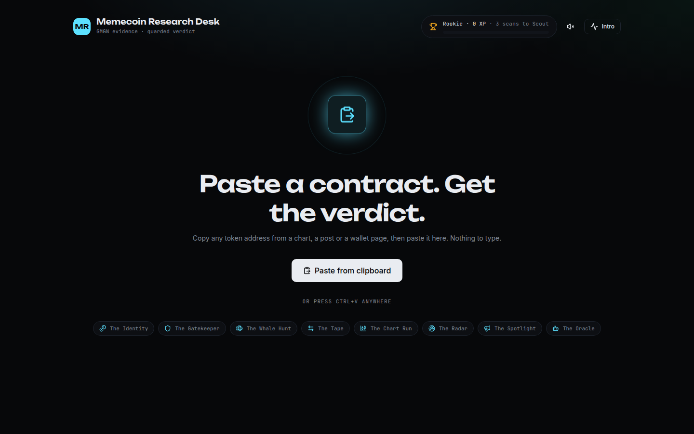
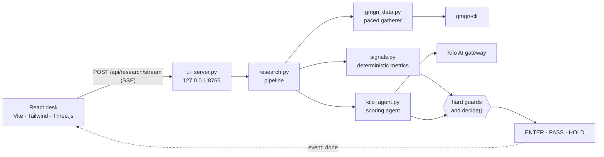

<div align="center">

# 🎬 Memecoin Cinema

### A research desk that turns a token contract into a verdict: **ENTER**, **PASS**, or **HOLD**


[Quick start](#-quick-start) · [How a scan works](#-how-a-scan-works) · [Decision engine](#-decision-engine) · [API](#-api-reference) · [Architecture](#-architecture) · [Security](#-security-model)



</div>

> ⚠️ **Research tool, not financial advice.** Memecoins are extremely high risk and most go to zero. This project never places trades, signs transactions, or touches private keys. Every verdict is one input to your own judgment.

---

## 📖 Contents

**Overview** · [Features](#-features) · [Scan flow](#-how-a-scan-works) · [Decision engine](#-decision-engine) · [Signals](#-signal-reference) · [Architecture](#-architecture)
**Setup** · [Quick start](#-quick-start) · [Configuration](#%EF%B8%8F-configuration) · [Using the desk](#%EF%B8%8F-using-the-desk) · [CLI](#-command-line-tools) · [API](#-api-reference)
**Reference** · [Progression](#-progression-layer) · [Security](#-security-model) · [Testing](#-testing-and-quality) · [Structure](#%EF%B8%8F-project-structure) · [Design](#-design-decisions) · [Roadmap](#-known-limitations-and-roadmap) · [Contributing](#-contributing) · [License](#-license-and-acknowledgments)

---

## 🌟 Overview

Memecoin Cinema is a local-first research console for memecoins on **Solana**, **BSC**, **Base**, and **Ethereum**. Paste a contract address and the desk:

1. Validates the address for its chain before any network call.
2. Pulls seven live data sources from GMGN through `gmgn-cli`, one at a time, so GMGN's rate limiter never bans the machine.
3. Computes deterministic signals: chart pattern, holder concentration, security flags.
4. Asks a scoring agent (via the Kilo AI gateway) for a structured opinion over those facts.
5. Applies hard guards that no model output can override.
6. Shows the evidence as a nine-reel cinematic sequence, so you watch the case build instead of staring at a spinner.

Four principles drive the design:

- **Facts first.** Code computes every number. The language model only reasons over those numbers.
- **Guards beat opinions.** A honeypot, an extreme rug ratio, or a single wallet holding more than 10% of supply forces `REJECT`, even if the agent says `APE`.
- **Local and inspectable.** The server binds to `127.0.0.1`. Every source, signal, and guard appears in the output.
- **Research only.** No trading, orders, wallet access, or token creation exist in this codebase.

---

## ✨ Features

| | Feature | What it gives you |
|:-:|---|---|
| 🔎 | **Seven-source scan** | Token identity, security audit, top-100 holders, trader tape, 15-minute candles, smart-money wallets, and KOL wallets. |
| 🧠 | **Explainable verdicts** | Each verdict carries a 0 to 100 safety score, reasons, top risks, and the exact guard that fired, if any. |
| 🛡️ | **Hard guards** | Honeypot, rug ratio, single-wallet supply, and rat-trader share are non-negotiable stops. |
| 📈 | **Chart reading** | Eight named price-action patterns plus consolidation states, with every scoring point explained. |
| 👥 | **Holder forensics** | Top-10 and top-20 concentration; sniper, rat-trader, bundler, dev, and airdrop-recipient share. |
| 🎞️ | **Cinema UI** | A nine-reel scan theatre in React, a lazy-loaded Three.js intro, and a verdict orb. |
| 🎮 | **Progression** | Ranks, badges, and encounters that reward disciplined scanning. Client-side only. |
| ⚡ | **Streaming results** | Server-sent events push each source to the screen the moment GMGN answers. |
| 🧪 | **Tested** | 30 unit tests covering validation, signals, guard rules, and an end-to-end stubbed pipeline. |

---

## 🎞️ How a scan works

Paste an address, pick a chain, press scan. Each reel develops as its data lands:

| # | Reel | GMGN source | What it shows |
|:-:|---|---|---|
| 1 | **Identity** | `token info` | Name, symbol, price, liquidity, holder count, creation time |
| 2 | **Gatekeeper** | `token security` | Honeypot flag, rug ratio, creator token status |
| 3 | **Holders** | `token holders` (limit 100) | Concentration, sniper, rat-trader, bundler, and dev share |
| 4 | **Tape** | `token traders` | Number of active traders |
| 5 | **Chart** | `market kline` (15m) | Chart pattern, trend, drawdown, volume confirmation |
| 6 | **Smart wallets** | `track smartmoney` (limit 200) | Whether smart-money activity mentions this token |
| 7 | **KOL voices** | `track kol` (limit 200) | Whether KOL activity mentions this token |
| 8 | **Agent** | Kilo gateway | Verdict, safety score, reasons, risks |
| 9 | **Verdict** | Guards plus agent | The final call |

The verdict words are deliberately plain:

| Internal verdict | Shown as | Meaning |
|---|---|---|
| `APE` | **ENTER** | Risk looks acceptable. Still size small. |
| `REJECT` | **PASS** | A hard guard fired, or the risks stack up. |
| `NEED_MORE_DATA` | **HOLD** | Core data is missing. Wait and re-scan. |

---

## 🧮 Decision engine

The logic lives in `scripts/research.py` (`guards` and `decide`). Rules run in this order:

1. **No core data:** if none of `token info`, `security`, `holders`, or `kline` answered, the verdict is `NEED_MORE_DATA` and the agent is not called.
2. **Hard guard fires:** verdict is `REJECT`. The safety score is capped at 20.
3. **Medium risks stack:** if the agent says `APE` but two or more medium flags are set, verdict becomes `REJECT`.
4. **Otherwise:** the agent's verdict stands.
5. **Agent unavailable:** GMGN data still displays, and the reason explains that scoring was skipped.

### Hard guards (force `REJECT`)

| Guard | Threshold |
|---|---|
| Honeypot | Contract blocks selling |
| Rug ratio | Above `0.30` |
| Largest wallet | Holds above `10%` of total supply |
| Rat traders | Hold above `5%` of total supply |

### Medium risks (two or more on an `APE` forces `REJECT`)

| Flag | Threshold |
|---|---|
| Top-10 wallets | Hold above `50%` of total supply |
| Sniper + rat-trader + bundler | Together above `30%` of total supply |
| Dev still holding | Creator status `creator_hold` |
| Weak chart | Pattern is `Breakdown`, `Distribution at highs`, or `Slow bleed` |

### Agent contract

The scoring agent gets a system prompt with the same rules, plus one JSON data block marked as untrusted. It must reply with exactly one JSON object:

```json
{
  "verdict": "APE | REJECT | NEED_MORE_DATA",
  "score": 0,
  "reasons": ["up to 5 short strings"],
  "risks": ["up to 3 top risks"],
  "missing": ["exact missing fields, if any"]
}
```

`parse_verdict` in `scripts/kilo_agent.py` rejects any reply without a known verdict, clamps `score` to 0–100, truncates each string to 300 characters, and keeps at most 8 items per list. Anything else raises, and the desk shows the error instead of a guess.

The human-readable rubric lives in [`agents.md`](agents.md). The code mirrors it, and the desk serves it at `/api/rules`.

---

## 📐 Signal reference

### Chart patterns (15-minute candles)

Patterns are checked top to bottom; the first match wins.

| Pattern | Condition |
|---|---|
| Vertical run-up | Slope above `0.25` and drawdown below `0.12` |
| Uptrend channel | Slope above `0.08` and drawdown below `0.25` |
| Breakdown | Drawdown above `0.55` and slope below `-0.10` |
| Bounce off the lows | Drawdown above `0.55` and slope above `0.02` |
| Distribution at highs | Drawdown above `0.35` and slope within `±0.08` |
| Slow bleed | Slope below `-0.20` |
| Basing at lows | Slope within `±0.05`, volatility below `0.05`, and under `0.20` up from the range low |
| Wide chop | Slope within `±0.08` and volatility above `0.08` |
| Consolidation | Otherwise: bullish, bearish, or sideways, by trend |

The chart score also weighs the short and long moving-average relationship, the trend over the last 20 bars, volume on the latest bar, volume fading against its average, position against the range high, and price-volume divergence. Every point added or deducted carries its reason in the output.

### Holder metrics

All shares are fractions of **total supply**, not float-adjusted. The output states this basis.

| Metric | Meaning |
|---|---|
| `top10_share` / `top20_share` | Combined share of the largest normal wallets |
| `largest_share` | Share held by the single largest normal wallet |
| `sniper_share` | Wallets tagged as snipers |
| `rat_trader_share` | Wallets tagged as rat traders |
| `bundler_share` | Wallets tagged as bundlers |
| `dev_share` | Wallets tagged as dev team or creator |
| `airdrop_share` | Balance held by wallets with no buy transactions |

Contract-type addresses are excluded, so concentration counts only normal wallets.

### Security flags

`honeypot` (is selling blocked), `rug_ratio` (GMGN's rug-risk score), and `creator_token_status` (whether the creator still holds tokens).

---

## 🏗️ Architecture



Every stage is a pure function over JSON except the two I/O edges, `gmgn_data.py` and `kilo_agent.py`. That is why the signal and guard logic is covered by fast tests with no network. `signals.py` does no I/O at all.

---

## 🚀 Quick start

### Prerequisites

| Requirement | Why |
|---|---|
| Python 3.10 or newer | Scripts use `dict \| None` annotations and the standard library only |
| Node.js 22 LTS or newer | Builds the React desk with Vite |
| `gmgn-cli` on `PATH`, authenticated | Every data source. Verify with `make config` |
| Kilo API key (optional) | Enables the scoring agent. Without it, GMGN data still shows |
| Docker Engine and Compose v2.24+ (optional) | Runs the desk as a container instead of on the host |
| Blender on `PATH` (optional) | Only needed to regenerate 3D assets with `make assets` |

### Run it

```bash
git clone git@github.com:hosseinmirzapur/memecoin-cinema.git
cd memecoin-cinema

# optional: enables the scoring agent (.env is gitignored)
echo "KILO_API_KEY=your-key-here" > .env

make ui          # installs npm deps, builds the React app, starts the server
```

Open **http://127.0.0.1:8765** and paste a contract address.

Change the port with `make ui PORT=9000`.

### 🐳 Docker

```bash
make docker-up      # docker compose up -d --build, serves on http://127.0.0.1:8765
make docker-logs    # follow the container logs
make docker-down    # stop and remove the deployment
```

Credentials stay outside the image. `.env` supplies `KILO_API_KEY`, and `~/.config/gmgn` is mounted read-only so `gmgn-cli` finds its keys (set `GMGN_CONFIG_DIR` to use another folder). `DESK_PORT` changes the host port.

| Hardening | Setting |
|---|---|
| Build | Multi-stage: Node builds the desk; runtime is `node:22-bookworm-slim` with Python 3 and `gmgn-cli` 1.5.0 |
| Runtime | uid 1000, read-only root, writable `/tmp` only (`noexec`), `cap_drop: ALL`, `no-new-privileges`, `init` |
| Network | Port on `127.0.0.1` only; the Host-header guard still applies |
| Limits and health | 512 MB memory, 256 processes, logs rotated at 10 MB × 3; `HEALTHCHECK` probes `/api/rules`, which uses no quota |

---

## ⚙️ Configuration

### Environment variables

Read from the process environment first, then from `.env` in the repository root. A variable already exported in the shell overrides the file.

| Variable | Default | Purpose |
|---|---|---|
| `KILO_API_KEY` | none | Authenticates the scoring agent. Missing key means scoring is skipped. |
| `KILO_BASE_URL` | `https://api.kilo.ai/api/gateway` | OpenAI-compatible gateway base URL |
| `KILO_MODEL` | `kilo-auto/free` | Model ID. List available models at `GET {base}/models`. |

Make variables: `PY` (interpreter, default `python3`) and `PORT` (control-panel port, default `8765`).

### Runtime limits

| Limit | Value | Reason |
|---|---|---|
| GMGN pacing | One call at a time, 2 s between starts | A burst previously triggered `RATE_LIMIT_BANNED` |
| GMGN call timeout | 45 s | Stops a hung `gmgn-cli` from stalling the scan |
| Fallback ban wait | 300 s | Used when GMGN reports a limit without a reset time |
| Agent request timeout | 90 s | Bounds one scoring call |
| Agent data cap | 12,000 characters | Keeps the prompt small and predictable |
| Subprocess timeout (UI routes) | 180 s | Bounds review, holder report, and test runs |

---

## 🖥️ Using the desk

- **Scan.** Choose a chain (`sol`, `bsc`, `base`, or `eth`), paste the address, and press scan. Reels develop as sources answer.
- **Holder report.** Runs the GMGN holder-analysis script for an address on `auto`, `sol`, `bsc`, `base`, or `eth`, in English or Chinese.
- **Rules.** The `agents.md` rubric is served at `/api/rules`, so the page and the decision logic share one source.
- **Sound.** Optional 8-bit cues for scan events. Off until you switch it on; the choice is remembered in the browser.

---

## 🔧 Command-line tools

```bash
# Full pipeline, prints one JSON verdict to stdout
python3 scripts/research.py sol <address>

# Quick markdown review, same validation, no streaming
python3 scripts/fast_review.py sol <address>

# GMGN holder analysis; the default language here is zh, pass en for English
python3 .agents/skills/gmgn-holder-analysis/analyze.py <address> <chain|auto> en
```

### Make targets

| Target | What it does |
|---|---|
| `make ui` | Build the desk, then start the control panel |
| `make assets` | Rebuild the five relic models in `ui/public/models` via Blender |
| `make test` | Run the unit suite (`unittest`, verbose) |
| `make check` | Compile every script, then run the suite |
| `make config` | Show `gmgn-cli config --check` |
| `make docker-build` | Build the container image |
| `make docker-up` / `docker-down` / `docker-logs` | Start, stop, or follow the Docker deployment |

---

## 🔌 API reference

The control panel only accepts requests with a `127.0.0.1` or `localhost` Host header. Every `POST` also requires the header `X-Ui: 1`, which browsers cannot send cross-site without a preflight that the server never answers.

| Method | Path | Body | Response |
|---|---|---|---|
| `GET` | `/` | none | Built React app. `503` if not built. |
| `GET` | `/api/rules` | none | `agents.md` as plain text |
| `GET` | `/api/config` | none | Output of `gmgn-cli config --check` |
| `POST` | `/api/research/stream` | `{"chain", "address"}` | Server-sent events (below) |
| `POST` | `/api/research` | `{"chain", "address"}` | Final verdict JSON, blocking |
| `POST` | `/api/review` | `{"chain", "address"}` | Quick markdown review. Chain must be fixed, not `auto`. |
| `POST` | `/api/holders` | `{"chain", "address", "lang"}` | Holder report. `lang` is `en` or `zh`. |
| `POST` | `/api/tests` | `{}` | Unit-test output and exit status |

### Streaming events

`/api/research/stream` answers with `text/event-stream`:

| Event | Sent when | Payload |
|---|---|---|
| `source` | Each GMGN call completes | `name`, `ok`, `ms`, `error`, short `preview` |
| `agent` | Scoring starts, then ends | `status` (`start`, `ok`, `error`), `model`, `error` |
| `done` | Verdict is final | The full result object |

### Example

```bash
curl -s -X POST http://127.0.0.1:8765/api/research \
  -H 'Content-Type: application/json' \
  -H 'X-Ui: 1' \
  -d '{"chain": "sol", "address": "<contract-address>"}'
```

---

## 🎮 Progression layer

Progress is a convenience. Ranks and badges live in the browser and reset if storage is blocked.

### Ranks (completed scans)

Rookie (0) → Scout (3) → Analyst (8) → Alpha Hunter (20) → Oracle (50)

### Badges

| Badge | Earned by |
|---|---|
| 🩸 **First Blood** | Finishing your first scan |
| 🧹 **Clean Sweep** | All seven GMGN sources answering in one scan |
| 🪤 **Trap Spotter** | Catching a honeypot before it catches you |
| 🐋 **Whale Watcher** | Finding one wallet holding over 10% of supply |
| 🧰 **Chest Hoarder** | Opening ten chests |

---

## 🔐 Security model

| Concern | Control |
|---|---|
| Network exposure | Server binds to `127.0.0.1` only. |
| DNS rebinding | Host header must be `127.0.0.1` or `localhost`. |
| Cross-site requests | Every `POST` requires `X-Ui: 1`. |
| Bad input | Addresses validated per chain (Solana base58 32–44 chars; EVM `0x` + 40 hex) before any external call. Bad input gets `400` before any stream event. |
| Command injection | Subprocesses run with argument lists, never through a shell. |
| Prompt injection | GMGN data is wrapped in a `<data>` block that the prompt marks as untrusted. Closing tags inside the data are escaped. The prompt forbids following instructions found in data. |
| Secrets | `.env` is gitignored. The API key is read from the environment and never written into results or responses. Recovery phrases are never requested. |
| Money movement | No wallet, signing, or order code exists in the repository. |

---

## 🧪 Testing and quality

```bash
make check      # compile all scripts, then run 30 tests
```

| Test module | Covers |
|---|---|
| `tests/test_scripts.py` | Address validation for both chain families, the holder CLI's bad-input and failure paths, and report generation |
| `tests/test_research.py` | Kline edge cases such as zero-price candles, holder concentration rules, honeypot string handling, address matching, and a stubbed end-to-end run covering event order, GMGN outage handling, honeypot capping, and missing-key behavior |

The desk is checked by `npm run build`. Run the suite in the image: `docker run --rm memecoin-cinema:latest python3 -m unittest discover -s tests`.

---

## 🗂️ Project structure

```text
memecoin-cinema/
├── agents.md                    # Research rules: pipeline, rubric, sizing, output format
├── Dockerfile                   # Multi-stage image: UI build, then hardened runtime
├── docker-compose.yml           # Loopback-bound, read-only deployment
├── .dockerignore                # Keeps secrets, caches and build inputs out of the image
├── Makefile                     # ui · assets · test · check · config · docker-*
├── docs/                        # Workspace status and iteration log
├── transcripts/                 # Operator source material behind the rules
├── scripts/
│   ├── ui_server.py             # Localhost HTTP server and SSE streaming
│   ├── research.py              # Pipeline: gather, signals, agent, guards, decide
│   ├── gmgn_data.py             # Serialized GMGN gatherer with cooldown
│   ├── signals.py               # Deterministic kline, holder, and security signals
│   ├── kilo_agent.py            # Scoring agent client and strict verdict parser
│   ├── validate_address.py      # Solana and EVM address validation
│   ├── fast_review.py           # Quick markdown review
│   └── blender/                 # Relic models and reel backdrop generators
├── .agents/skills/              # GMGN skills and the holder-analysis script
├── tests/                       # unittest suite (30 tests)
└── ui/
    ├── src/
    │   ├── App.jsx              # Desk shell
    │   ├── cinema/              # Nine-reel scan theatre
    │   ├── scene/               # Three.js intro and verdict orb
    │   ├── components/          # HUD, evidence, verdict, sparkline, toasts
    │   ├── game/                # Progression, quests, sound, paste detection
    │   ├── hooks/useScan.js     # Scan state reducer driven by the SSE stream
    │   └── api.js               # Client for the local endpoints
    ├── public/models/           # Five GLB relic models
    └── vite.config.js           # Build, alias, and dev-server proxy to :8765
```

---

## 🧭 Design decisions

- **One GMGN call at a time.** A parallel burst tripped GMGN's rate limiter on a live run and banned the IP. Serial calls with spacing cost seconds, not reliability.
- **Guards live in code, not in the prompt.** A model can be argued into `APE`. A conditional cannot. Hard stops are deterministic and tested.
- **The model sees facts, not raw dumps.** Signals are computed first and capped at 12,000 characters.
- **Browser storage is cosmetic only.** Progress and the intro flag are conveniences. Anything that matters comes from the server, and storage failures never break the page.
- **Free-tier default model.** Keeps cost low. Verdicts can vary, so the guards carry the hard cases and the parser rejects malformed output.

---

## ⚠️ Known limitations and roadmap

### Known limitations

- Holder shares are fractions of total supply, not float-adjusted. Large locked or burned supply can make concentration look lower than it is.
- Charts use 15-minute candles only. Short-lived launches may show little structure.
- Agent verdicts depend on the chosen model and can drift between runs. Treat the score as advisory and the guards as authoritative.
- The rules in `agents.md` come from operator transcripts. They are not backtested or statistically validated.

### Roadmap

- [ ] Multi-timeframe chart analysis (1m, 5m, 1h)
- [ ] Float-adjusted holder metrics
- [ ] Backtesting harness that replays past scans against outcomes
- [ ] Recorded fixtures so the full pipeline runs offline

### Out of scope

Trading, order placement, wallet connections, and token creation. These remain explicitly out of scope until a human-approved design says otherwise.

---

## 🤝 Contributing

- One logical change per commit, with a conventional prefix: `feat`, `fix`, `docs`, `test`, `chore`, `refactor`.
- `make check` must pass. Never commit `.env`, keys, or recovery phrases.
- New skills state their auth, failure modes, and output schema, and rule changes are logged in `docs/index.md`, per [`agents.md`](agents.md).

---

## 📄 License and acknowledgments

No license has been chosen yet. Add a `LICENSE` file before accepting outside contributions or allowing reuse.

Built with [GMGN](https://gmgn.ai) data, the [Kilo AI](https://kilo.ai) gateway, [React](https://react.dev), [Vite](https://vitejs.dev), [Tailwind CSS](https://tailwindcss.com), [Three.js](https://threejs.org), [React Three Fiber](https://r3f.docs.pmnd.rs), [Framer Motion](https://motion.dev), [Radix UI](https://www.radix-ui.com), and [Blender](https://www.blender.org).

<div align="center">

**Look before you leap. Let the guards speak first.** 🎬

</div>
